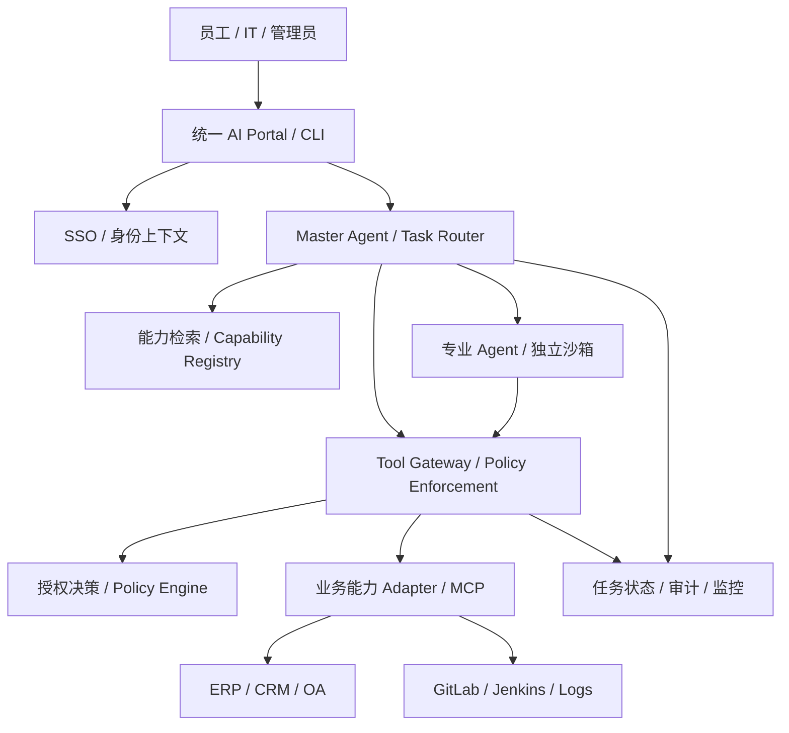
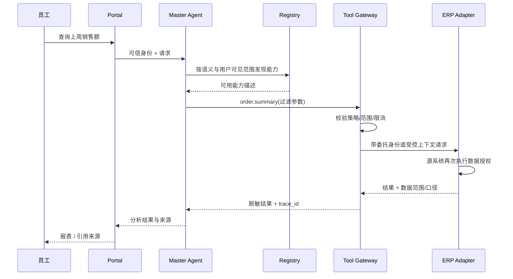
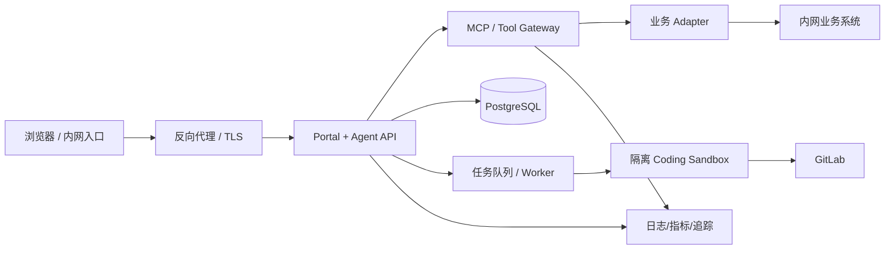
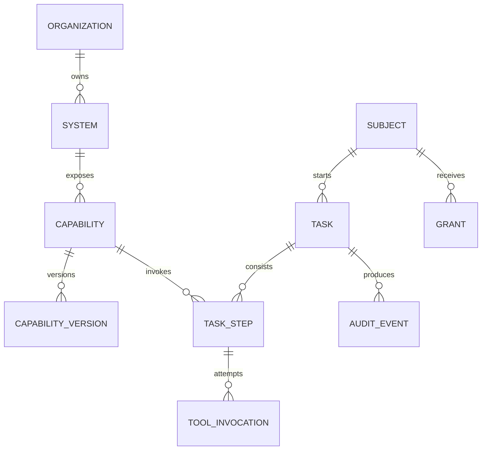
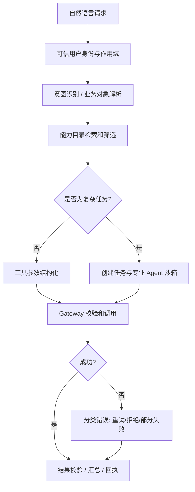
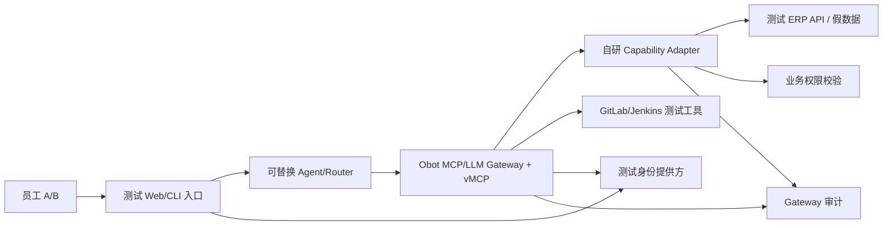

# 企业 AI 能力操作系统 ECAOS

**软件工程文档合订本 · V1.1**  
**日期：2026-11-23**  
**阶段：规划 / Obot 条件性推荐，待 PoC**

> 该版本统一整合 ADR-002 与底座 PoC 测试计划，所有候选平台能力仍须在相同环境下实测验证。

---


---

# 00. 项目章程与范围（Project Charter）

**文档版本**：V1.1　**状态**：待立项评审　**产品代号**：ECAOS

## 1. 背景与问题

组织内部长期维护多套相互独立的 ERP、CRM、OA、工单、IT 运维等系统。员工完成一项业务任务时，需要在多个界面查数、导出、整合、回写；IT 工程师需要在不同项目的仓库、日志、CI/CD、Coding Harness 之间切换。单点 AI 助手改善交互但未消除系统间能力孤岛。

## 2. 使命与商业定位

**使命**：以尽可能少的遗留系统改造，让现有企业软件可被 Agent **发现、理解、授权、组合、执行和审计**。

**差异化定位**：不直接与大型企业 Agent 平台竞争通用模型/聊天/知识能力；聚焦中小与中型企业自研系统/传统系统的低成本 AI 适配，沉淀可复用的业务能力规范、接入 SDK/生成器与业务语义治理方法。

## 3. 可衡量目标（拟定，待试点基线确定）

| ID | 目标 | 初期验证方法 |
|---|---|---|
| O-01 | 至少接入 2 个相互独立的系统 | 1 个业务系统 + 1 个 IT 工具链 |
| O-02 | 用户一次对话完成跨系统查询与报告 | 无需跳转原系统，保留来源链路 |
| O-03 | 同一工具对不同员工自动应用不同数据范围 | 授权/未授权对照测试 |
| O-04 | IT 从自然语言故障描述定位仓库并提交修复 MR | 演示仓库→诊断→修复→测试→MR |
| O-05 | 每次写入操作具备可追踪记录 | trace_id、actor、resource、version 等字段齐全 |
| O-06 | 常规授权操作无需逐次管理层审批 | 遵循事前授权和运行时策略，不违背源系统规则 |

## 4. 交付范围

### In Scope（MVP）

- Web 对话入口、企业身份接入（试点可先 OIDC）、用户/组/项目权限同步；
- 能力注册中心、能力版本/上下线/发现、Agent 调用工具目录；
- REST/OpenAPI 适配 MCP、至少 1 个自定义 Adapter；
- 受控 Tool Gateway：身份传播、策略判定、数据范围、安全日志；
- 两个示范场景：业务问数及报告生成；IT 排障与修复至 MR（不自动发布生产）；
- 任务追踪、异常重试与可观测性；单企业试点部署与开发者文档。

### Out of Scope（MVP）

- 重写原业务系统，建立完整 BI/ERP/CRM 替代品；
- 自动修改财务凭证或资金操作，跨系统分布式强事务；
- 无人审核的生产部署、批量删除等高风险动作；
- 通用多租户 SaaS 计费体系、复杂组织矩阵 BPM、海量并发承诺。

## 5. 相关方与 RACI（建议）

| 活动 | 产品负责人 | 技术负责人 | 业务系统负责人 | 安全/运维 | 测试/用户代表 |
|---|---|---|---|---|---|
| 需求与范围基线 | A | R | C | C | C |
| 架构与技术选型 | C | A/R | C | C | I |
| 能力契约与业务口径 | C | R | A/R | C | C |
| 身份权限验收 | C | R | C | A/R | C |
| PoC 与集成实现 | I | A/R | R | C | C |
| 验收与推广 | A | R | R | C | R |

R=负责执行，A=最终负责，C=咨询参与，I=知会。

## 6. 核心假设与约束

- 源系统至少可通过 API、只读数据库或合法受控自动化访问其业务能力；无需给模型直接数据库管理凭据。
- 源系统有明确的业务权限与数据归属规则；缺失时应先补齐，不能交给 Prompt 代替。
- 首期复用一款开源/商业开放平台作为 Agent 与 MCP 基础设施；仅在验证缺口后研发替代模块。
- 使用生产数据前须完成敏感数据评估、组织合规审核与访问记录设计。

## 7. 立项阶段门槛（Gate 0）

V1.1 补充：底座技术选择为 **Obot 条件性优先 PoC、Archestra 对照**，不代表已经完成采购与部署。相关阻断条件参见《14 ADR-002》和《15 底座选型 PoC 执行计划》。Gate 0 必须明确试点身份源、内网测试环境以及不使用生产敏感数据。

通过以下条件方可进入详细开发：①选定 2 个试点系统及业务负责人；②获得 API/只读数据访问许可；③明确组织认证来源；④确定 POC 候选底座、许可可行性；⑤冻结首期 8—12 个业务能力；⑥确认第一期风险与验收标准。


---

# 01. 产品需求规格说明书（PRD）

## 1. 用户与核心工作

| 角色 | 痛点 | 预期价值 |
|---|---|---|
| 业务员工 | 同一报表涉及多系统导出和合并 | 一个入口问数、生成报告与回写获授权信息 |
| 部门主管 | 数据口径混乱、跨部门协作成本高 | 业务语义统一、组织级数据范围可信 |
| IT 工程师 | 多代码仓库、日志平台、CI/CD 切换 | 一个任务完成诊断、代码修复、测试及 MR |
| 平台管理员 | 每个 Agent 单独配置账号和工具 | 统一认证、能力目录、权限与审计 |
| 系统开发者 | 每接一个 Agent 重新开发系统集成 | 通过能力契约和 SDK 一次封装、多处使用 |

## 2. 产品原则与用户体验

- **自然语言驱动**，用户不需要记项目路径或系统地址。
- **直接执行授权动作**，低风险、可逆操作不引入额外层层审批。
- **可观察**，告诉用户调用了哪些能力、来源、完成/失败项及后续建议。
- **可恢复**，长任务可查询进度，重复提交不会导致重复写入。
- **可追溯**，敏感信息脱敏，关键修改有前后状态与关联 trace_id。

## 3. 核心场景

### UC-01：跨系统销售问数并生成报告

**前提**：用户已登录，具有特定区域的订单与客户读取权限，相关能力已注册。

**正常流**：输入“分析上周华南地区订单变化并生成客户跟进清单”→ 识别指标 → 检索 ERP/CRM 能力 → 应用用户数据范围 → 返回统计、来源口径和报告 → 用户可选择把草稿回写 CRM。

**异常**：缺乏授权则拒绝/提示请求访问；业务指标含糊则澄清口径；上游接口失败则告知缺失项，不补造数据。

### UC-02：授权更新客户跟进状态

**前提**：用户对该客户具有 `crm.customer.write` 权限。

**正常流**：模型识别客户和目标状态 → 查询最新版本 → 受控工具校验字段、授权、版本与业务规则 → 执行更新 → 返回新状态与审计号。

**异常**：客户并非其负责范围、记录版本冲突、业务规则不允许时禁止更新；允许重试但必须使用幂等键。

### UC-03：IT 故障诊断到修复 MR

**前提**：工程师有仓库/日志读取和创建分支权限；执行沙箱可用。

**正常流**：描述系统故障 → 系统目录匹配仓库和部署 → 查询最近日志/变更 → 启动独立 Coding Agent → 修改并运行测试 → 形成 MR、测试报告与故障分析。

**边界**：MVP 不自动部署生产；编码 Agent 不直接持有生产管理员凭据。

### UC-04：系统接入和能力发布

**前提**：系统负责人/管理员创建系统记录并上传 OpenAPI 契约或自定义 Adapter。

**正常流**：注册能力 → 配置业务语义、输入、权限和数据范围 → 连通性与合规测试 → 发布指定版本 → 授权用户/组可以发现和使用。

## 4. 需求优先级

| ID | 功能 | 优先级 | 版本 |
|---|---|---|---|
| P-01 | 员工登录、身份与组织信息映射 | P0 | MVP |
| P-02 | 项目/系统及能力注册管理 | P0 | MVP |
| P-03 | REST/OpenAPI 到 MCP 的能力适配 | P0 | MVP |
| P-04 | 用户/组/项目/工具级授权与数据范围 | P0 | MVP |
| P-05 | 能力发现、调用结果格式化 | P0 | MVP |
| P-06 | 业务问数与分析报告 | P0 | MVP |
| P-07 | 低风险写入与幂等/审计 | P0 | MVP |
| P-08 | IT 项目路由、日志读、修复 MR | P0 | MVP |
| P-09 | 执行日志、任务状态、错误反馈 | P0 | MVP |
| P-10 | 能力运行健康度/版本生命周期 | P1 | V1.1 |
| P-11 | 任务模板、定时任务、事件触发 | P1 | V1.1 |
| P-12 | 跨系统写入补偿与恢复控制台 | P1 | V1.1 |
| P-13 | 多租户自助开通及 SaaS 计费 | P2 | V2.0 |
| P-14 | 技能市场、合作伙伴自助发布 | P2 | V2.0 |

## 5. 明确不做的事情

首期不追求让 Agent 通过浏览器模拟所有后台操作；无 API 的老系统只作为选择性过渡方案。首期不建设通用 OA 审批系统，不复制原系统所有页面，不将一次性人工批准作为常规读写的前提。

## 6. 成功指标（试点需采集基线再确定目标）

- 跨系统任务平均人工切换系统次数；任务总耗时和人工操作时长；
- 工具路由成功率、指标正确率、未授权访问阻断率；
- 接入一个已有 REST API 的新系统所需人日；
- 有记录可追踪的写操作占比、失败恢复率、用户满意度。


---

# 02. 软件需求规格说明书（SRS）

## 1. 运行与外部接口

- **客户端**：Web（必选），企业微信与 CLI（后续），UTF-8 中文优先。
- **认证**：OIDC/OAuth2（试点）；平台不可仅依赖客户端上传的 user_id。
- **源系统接入**：HTTPS REST/OpenAPI、MCP、GitLab API、Jenkins API、日志只读 API。
- **基础设施**：PostgreSQL 用于元数据与任务状态；Secrets Manager/密钥库；指标、日志和 Trace。

## 2. 功能性需求（均可测试）

| FR-ID | 功能需求 | 可验收行为 | 优先级 |
|---|---|---|---|
| FR-001 | 登录与身份映射 | 可用可信 Token 取得用户/组/部门上下文 | P0 |
| FR-002 | 系统注册 | 管理员创建/更新系统与环境及 Owner | P0 |
| FR-003 | 能力元数据注册 | 校验契约、唯一 ID、版本、工具 Schema | P0 |
| FR-004 | 能力检索与发现 | 只返回当前用户获授权的能力 | P0 |
| FR-005 | API/MCP 适配 | 至少两类源：OpenAPI、定制 Adapter | P0 |
| FR-006 | 工具授权 | 每次调用按主体、工具、动作和资源策略判断 | P0 |
| FR-007 | 数据范围过滤 | 源系统按身份与行/字段规则强制限制数据 | P0 |
| FR-008 | 问数与结果来源 | 提供口径、时间范围、数据来源、缺失说明 | P0 |
| FR-009 | 低风险数据更新 | 业务校验、幂等键、版本控制、审计回执 | P0 |
| FR-010 | Agent 路由 | 简单任务直连工具；复杂任务才启动专业 Agent | P0 |
| FR-011 | IT 项目路由 | 根据业务别名找到正确仓库、日志与测试管线 | P0 |
| FR-012 | 编码沙箱执行 | 代码修改仅在隔离工作区，生成 MR 和测试结果 | P0 |
| FR-013 | 任务状态管理 | 可查询 pending/running/succeeded/failed 等状态 | P0 |
| FR-014 | 调用审计 | 记录 actor、tenant、capability、trace、策略结果 | P0 |
| FR-015 | 管理界面 | 能发布/停用能力、授权、查看审计与故障 | P0 |
| FR-016 | 能力版本治理 | 兼容性与回滚记录、停用行为可见 | P1 |
| FR-017 | 事件驱动任务 | 事件/计划触发并传入执行身份与作用域 | P1 |
| FR-018 | 失败补偿 | 支持跨系统写入的重试/补偿任务 | P1 |

## 3. 非功能需求（建议初始验收目标，非实测值）

| NFR-ID | 目标 | 试点测量条件 |
|---|---|---|
| NFR-001 | 平台自有 API P95 <= 500ms | 排除上游模型/源系统耗时，50 并发请求 |
| NFR-002 | 典型只读问数端到端 P95 <= 15s | 预置 1000 条测试数据、单次问数不超过 3 个工具 |
| NFR-003 | 试点平台可用性 >= 99.5% | 上线后按自然月度统计，排除经认可的维护窗口 |
| NFR-004 | 未授权工具调用阻断率 100% | 自动化越权测试套件，无已知绕过 |
| NFR-005 | 写操作审计覆盖率 100% | 采样和日志/数据库一致性校验 |
| NFR-006 | 重复同幂等键写调用不产生重复业务副作用 | 失败注入与并发重试测试 |
| NFR-007 | 敏感凭据不得出现在模型上下文与普通日志 | DLP/日志抽检与代码扫描 |
| NFR-008 | 业务工具调用追踪覆盖率 >= 99% | Trace ID 可贯通 Agent → 网关 → Adapter |
| NFR-009 | 关键配置备份支持恢复演练 | 在隔离环境完成至少一次恢复演练 |

## 4. 业务规则（不变量）

- BR-001：未获授权的能力不可在发现列表中出现，直接猜测调用 ID 也必须拒绝。
- BR-002：**工具授权与数据授权均在服务端判定**；模型结果不具备授权效力。
- BR-003：默认拒绝，任何 `tenant_id`、`department_id`、`scope` 不信任来自 LLM 的裸参数。
- BR-004：授权撤销后，新发起调用必须立即使用最新有效权限；长任务在关键执行点重新检查。
- BR-005：有业务副作用的工具需声明风险级别、幂等或防重策略与补偿能力。
- BR-006：IT 自动修复不得未经发布控制进入生产环境。
- BR-007：未知指标/不完整源数据不得以推测结果冒充已核验事实。

## 5. 需求可追踪性

| 需求 | 对应场景 | 验收用例 |
|---|---|---|
| FR-001/004/006/007 | UC-01/02 | TC-AUTH-01~05 |
| FR-003/005/015 | UC-04 | TC-CAP-01~04 |
| FR-008 | UC-01 | TC-DATA-01~04 |
| FR-009/014 | UC-02 | TC-WRITE-01~05 |
| FR-010/011/012/013 | UC-03 | TC-IT-01~05 |

## 6. 依赖与待澄清点

- 业务系统是否支持用户委托令牌（OBO），还是需要网关以服务账号访问并由源系统校验业务身份？
- 是否存在部门内行级数据授权、用户变动实时同步要求？
- 能否拿到项目日志 API 与测试环境？
- P95、峰值并发、业务数据保留期、数据出境/模型供应商策略需由试点组织确认。


---

# 03. 系统总体架构设计（HLD）

## 1. 架构决策概览

**架构模式**：客户端/身份层 + Agent Runtime + 企业能力控制平面 + 业务适配层 + 现有系统。

不将“每个系统都部署常驻 Agent”作为前提；每个业务系统首先注册**能力**，需要推理、编程或长任务时按需实例化专业 Agent。

## 2. 上下文图



## 3. 组件职责与边界

| 组件 | 职责 | 不能承担的职责 |
|---|---|---|
| Portal | 登录、会话、结果呈现、任务追踪 | 信任用户自报权限 |
| Master Agent | 意图/能力匹配、任务拆解、答案合成 | 发放全局管理员凭据、绕过工具授权 |
| Capability Registry | 能力元数据、语义、版本、Owner、健康状态 | 自行判定业务数据的真实性 |
| Tool Gateway | 鉴别身份、授权、参数验证、调用、速率和审计 | 替代源系统行级/字段级权限 |
| Policy Engine | RBAC/ABAC 策略判定，拒绝默认 | 代替业务状态机和财务规则 |
| Capability Adapter | REST/MCP 转换、领域语义和错误映射 | 绕过业务服务直接高权限修改 DB |
| Task Engine | 状态、重试、超时、补偿、任务恢复 | 替代 Agent 的自然语言推理 |
| Sandbox Worker | 拉代码、分析、测试、提 MR | 拥有生产环境 root 权限 |
| Observability | Trace、结构化日志、指标和告警 | 保存明文密钥或敏感原始数据 |

## 4. 关键请求序列：员工问数



## 5. 写操作序列与边界

1. 由 LLM 生成**待执行结构化参数**，不可提交任意 SQL / Shell 作为业务写入。
2. Gateway 用可信会话身份做权限判定并限定影响范围；Adapter 验证 schema、业务状态、乐观锁、幂等键。
3. 风险低且预授权的操作自动执行；需额外确认的高风险动作按策略升级，不将逐级审批视为默认。
4. 执行后由源系统返回操作凭证或新版本；记录执行摘要与追踪链路。

## 6. IT 修复任务序列

`故障描述 → 项目/别名匹配 → 只读日志/部署记录 → 沙箱克隆仓库 → Coding Agent 修复 → 测试 → MR → 回执`。

生产发布在 MVP 外；后续增加受控 Jenkins Tool，采用独立发布权限、质量门禁、可回滚部署策略。

## 7. 部署拓扑（试点建议）



首期允许单机 Docker Compose 开发演示；生产按网络分区、容器隔离、密钥托管和备份策略部署，不把 demo Compose 直接视为生产架构。

## 8. 技术选型原则

- **MCP/LLM 网关候选：Obot 优先 PoC，Archestra 对照**（ADR-002 条件性推荐，未实测）；两者不并联叠加。重点验证真实员工身份传递、细粒度数据权限、Profile 累加授权、OpenAPI 适配局限、商业许可、内网运行和可恢复性。
- **能力与业务边界：ECAOS 自研 Capability Contract、业务语义、可信 Adapter 和源系统授权**，不依赖网关的私有工具元数据作为企业核心领域模型。
- **替换策略：Master Agent 与业务 Adapter 仅依赖平台定义的 Gateway Port/契约**，将 Obot/Archestra 差异封装在单独适配器中。
- **权限决策**：初期可基于现有 IAM + 服务端策略；复杂 ABAC 后再评估 OPA。
- **任务执行**：MVP 使用持久化任务表与 Worker；跨天/多步复杂任务出现后评估 Temporal，避免过早引入重量级工作流。
- **存储**：PostgreSQL 记录业务平台元数据与状态；原 ERP/CRM 仍保有业务事实数据。

## 9. 候选底座的职责映射与限制

| 位置 | 设计归属 | 已知风险及应对 |
|---|---|---|
| MCP Registry / Virtual MCP | Obot（候选） | 多个 Profile 权限叠加，必须与 ECAOS 授权策略交叉校验 |
| OpenAPI → MCP | Obot Hosted OpenAPI Runtime 或 ECAOS Adapter | 只适合部分场景；员工身份/OAuth 委托及业务语义需自研补足 |
| 员工真实身份 | 企业 IdP + ECAOS 可信身份上下文 | 禁止把任意客户端 Header 当作独立可信身份；要求端到端校验 |
| 动态能力发现 | ECAOS Capability Registry + Gateway Catalog | 目录只能返回当前用户可见且健康的能力，不能越权暴露元数据 |
| 业务最终授权 | 业务 Adapter / 源系统 | 行级、字段级和状态权限必须由业务服务端校验 |
| Coding Agent | 独立隔离 Sandbox（非网关内高权限 Shell） | 只读诊断、测试和 MR；生产部署不属于 MVP 自动操作 |
| 审计证据 | 网关事件 + ECAOS 业务事件 | 统一 Trace ID，确认业务执行结果而非只记录工具成功 |

## 10. 质量属性

安全：最小权限、源系统再次鉴权；可靠：幂等、超时与有限重试；可维护：版本化契约；可扩展：Adapter 插件化；可观察：分布式 trace；成本：先工具后子 Agent，按需加载能力描述。


---

# 04. 领域模型与数据模型（DDD-lite）

## 1. 领域边界

- Identity Context：用户、组、部门、角色与可见资源范围（外部 IdP 为身份真相）。
- Capability Catalog：系统、能力、版本、领域语义、使用策略、测试报告。
- Execution Domain：任务、步骤、工具调用、执行结果与补偿。
- Governance：权限策略、审计记录、密钥引用、风险等级。

## 2. 核心实体

| 实体 | 主键/重要字段 | 说明 |
|---|---|---|
| organization | org_id, name | 首期单组织，也保留逻辑隔离键 |
| subject | subject_id, idp_issuer, external_sub, status | 人员/服务主体映射，不保存用户密码 |
| system | system_id, org_id, name, owner_id, environment | ERP/CRM/IT 等源系统注册 |
| capability | capability_id, system_id, domain, action, risk | 逻辑能力 ID，不跟 Agent 强绑定 |
| capability_version | capability_id, semver, schema_json, status | 版本内容快照与生命周期 |
| adapter_endpoint | adapter_id, system_id, base_url, auth_ref | 受控连接地址，不在 DB 明文存凭据 |
| grant | grant_id, subject_or_group, action, resource_pattern | 授权记录，含有效期/资源范围 |
| task | task_id, actor_id, status, intent, trace_id | 用户任务和进度 |
| task_step | step_id, task_id, capability_id, state, attempts | 可重试步骤及关联依赖 |
| tool_invocation | invocation_id, step_id, policy_result, latency_ms | 工具调用元数据和结果摘要 |
| audit_event | event_id, org_id, actor_id, action, resource, trace_id | 不可随意改写的审计事件 |

## 3. 数据关系



## 4. 任务状态机

`queued → routing → running → succeeded`；异常分支 `running → retry_wait → running / failed`；用户撤销为 `cancel_requested → cancelled`。部分完成时标记 `partial_success`，不得报告“全部完成”。

- 任务状态更新必须采用原子条件更新或乐观锁，禁止多 Worker 并发重复推进同一状态。
- 写入步骤使用 `idempotency_key`；同一业务副作用不能仅靠任务重试策略防重。
- 调用记录和审计为不同概念：前者用于排障，后者用于追责和策略验证。

## 5. 数据隔离与保留

- 所有平台元数据携带 `org_id`；资源访问始终从可信主体上下文确定租户，不以模型参数作为依据。
- 审计日志仅保留必要的输入输出摘要、脱敏标识和关联信息；原始报表内容按组织策略单独保留。
- 保留期、删除策略、备份加密与数据位置须由试点组织与法律合规要求决定，当前规划版不预设统一值。


---

# 05. 企业业务能力接入规范（Capability Contract v0.1）

## 1. 目标

向任意 Agent 提供**可理解、可发现、可授权、可调用、可恢复**的业务能力，同时保持业务规则由源系统掌握。MCP 是通信工具协议，本文件定义的是其上层的**业务元数据约定**，不是 MCP 官方标准。

## 2. 能力字段定义

| 字段 | 必选 | 定义 |
|---|---|---|
| capability_id | 是 | 不变全局 ID，如 `erp.order.search` |
| version | 是 | SemVer（重大不兼容升级主版本） |
| system_id | 是 | 源系统的稳定 ID |
| business_domain | 是 | 业务领域，如 `sales.order` |
| name / description | 是 | 用户可理解的中文名称与语义 |
| input_schema | 是 | JSON Schema，含字段限制 |
| output_schema | 是 | JSON Schema，含业务统计口径 |
| permission | 是 | 最小平台权限，及数据范围要求 |
| risk_level | 是 | `read_only / low_write / high_impact` |
| side_effect | 是 | `none / idempotent_write / non_idempotent_write` |
| adapter_ref | 是 | 执行 Adapter 的逻辑引用 |
| timeout_ms | 是 | 最大单步执行时限 |
| idempotency | 是 | 幂等能力声明（写入时尤为重要） |
| owner / data_classification | 是 | 业务负责人 / 数据敏感度 |
| examples | 建议 | 正例与反例，帮助工具检索与测试 |

详细验证规则见 [`../specs/capability.schema.json`](../specs/capability.schema.json)。

## 3. 能力发布生命周期

`draft → validating → published → deprecated → disabled`。

- draft：尚不能被普通 Agent 发现；
- validating：检查 schema、连通、权限、越权样例、业务口径；
- published：可授权发现与调用；
- deprecated：仍可调用但返回迁移提示；
- disabled：直接拒绝新调用并保留历史审计。

## 4. Adapter 选择顺序

1. 已有可靠业务 API → OpenAPI 导入并完善语义与权限；
2. 需特殊鉴权/签名 → 独立 Adapter 服务；
3. 没有业务 API 的只读报表 → 受控只读视图 + 专用查询服务；
4. 无 API 的遗留 UI → 经批准使用受控 RPA 作为过渡，不作为关键业务长期主路径。

不得使用无限制 SQL 执行器、任意 Shell、共享管理员浏览器 Cookie 充当通用业务能力。

## 5. 输入与业务语义

- 描述 `startDate/endDate` 的时区、包含边界、时间戳精度；
- `amount` 必须说明币种、税前/税后、已支付/已结算口径；
- `customerId` 不可被模型直接用任意值越权遍历；
- 对集合查询设置最大时间跨度、最大返回行数、分页策略、PII 脱敏；
- 聚合查询明确数据时点与刷新周期。

## 6. 写入契约

写入动作最少应具备：操作对象、字段白名单、提交人上下文、乐观锁版本、幂等键、效果摘要、可回滚性声明，以及有明确语义的错误码。

高风险操作默认不纳入 MVP。对已授权低风险写入，支持自动执行，不加默认人工逐条审批。

## 7. 错误约定

| code | 含义 | Agent 应对 |
|---|---|---|
| UNAUTHORIZED | 身份无效 | 要求重新登录，不猜凭据 |
| FORBIDDEN | 无操作/数据权限 | 明确拒绝，不重试绕过 |
| VALIDATION_ERROR | 输入参数不合法 | 根据 schema 修正一次 |
| VERSION_CONFLICT | 目标记录已变更 | 重新读取，必要时征询用户 |
| UPSTREAM_UNAVAILABLE | 上游暂不可用 | 有界指数退避，显示部分失败 |
| RATE_LIMITED | 达到限制 | 按 Retry-After 延迟，不并发轰炸 |
| IDEMPOTENCY_CONFLICT | 同一 key 参数不一致 | 停止调用，需新业务指令 |

## 8. 工具质量门禁

一个新能力只有通过契约校验、最小权限测试、数据范围测试、异常测试与 Owner 签字确认语义，才可在生产目录发布。发布流程可以自动化，其目的是**能力治理**，不是要求每个员工任务都人工批准。

## 9. V1.1 底座适配接口与禁止事项

- Capability Contract 属于 ECAOS 自定义规范，须独立于 Obot/Archestra 的私有工具描述和配置存储。
- 第一类：标准 OpenAPI 查询工具，可尝试 Obot 自带转换，但必须验证参数、错误映射和数据权限；不满足条件时使用自研 MCP Adapter。
- 第二类：涉及真实员工 OAuth 委托、行级过滤、业务状态校验与低风险写入的操作，原则上由自研可信 Adapter 封装。
- 第三类：代码仓库、日志和 CI 工具，由专用执行节点访问，不向普通员工开放任意 Shell/SQL。
- 注册需同时定义 `actor_propagation`、`permission_scope`、`data_scope`、`side_effect`、`idempotency`、`audit_policy` 的实现与测试责任，缺少校验不得标记生产可用。
- 发布流程实行 adapter contract test + permission matrix test；网关升级时必须重跑身份与工具可见性回归。


---

# 06. 平台接口设计（API Design v0.1）

> 以下接口是**建议的 ECAOS 自研外部契约草案**，不是 Obot 或 Archestra 已存在的兼容 API。V1.1 选型采用“Obot 优先 PoC、Archestra 对照”，正式对接须由 Gateway Adapter 完成协议映射；禁止业务代码直接依赖候选网关的私有接口。

## 1. REST 原则

- base path：`/api/v1`，HTTPS；Token 从可信 IdP 取得，后端验证发行者、受众、有效期与用户映射。
- 全局追踪头：`X-Trace-Id`（缺失由网关生成），响应回传。
- 写入头：`Idempotency-Key`（必传）；变更条件通过 `If-Match` 或 `expected_version`。
- 错误响应统一为 `error.code/message/details/trace_id`，不得回显上游密钥或完整敏感数据。

## 2. 核心接口草案

| 方法 | 路径 | 作用 | 权限 |
|---|---|---|---|
| GET | `/me` | 当前身份与可见资源摘要 | 已登录 |
| GET | `/systems` | 系统目录（过滤授权） | system.read |
| POST | `/systems` | 注册源系统 | system.manage |
| GET | `/capabilities?query=...` | 动态搜索可用能力 | capability.discover |
| POST | `/capabilities` | 注册能力草稿 | capability.manage |
| POST | `/capabilities/{id}/versions/{v}/publish` | 发布版本 | capability.publish |
| POST | `/capability-invocations` | 执行能力 | tool.invoke + 业务权限 |
| POST | `/tasks` | 创建多步任务 | task.create |
| GET | `/tasks/{task_id}` | 查询任务状态 | task.read_own / admin |
| GET | `/audit-events` | 审计查询 | audit.read |

## 3. 执行请求示例

```http
POST /api/v1/capability-invocations
Authorization: Bearer <access-token>
Idempotency-Key: 2ff9af23-8c4f-4a03-9e9e-59751b009260
Content-Type: application/json
```

```json
{
  "capability_id": "erp.order.search",
  "version": "1.0.0",
  "input": {
    "startDate": "2026-11-01",
    "endDate": "2026-11-22",
    "region": "south-china",
    "pageSize": 30
  }
}
```

**注意**：客户端不得自报 `effective_user_id`、`org_id` 或可见客户列表，必须从受信 Token 和服务端组织目录推导；请求中的 `region` 也必须与用户实际数据范围相交后传给源系统。

### 成功响应示例

```json
{
  "invocation_id": "inv_01X",
  "trace_id": "trc_01X",
  "status": "succeeded",
  "capability_id": "erp.order.search",
  "result": { "rows": [], "total": 0 },
  "data_freshness": "realtime",
  "policy": { "decision": "allow" }
}
```

### 失败响应示例

```json
{
  "error": {
    "code": "FORBIDDEN",
    "message": "无权访问指定数据范围",
    "details": { "resource_type": "order" },
    "trace_id": "trc_01X"
  }
}
```

## 4. 异步任务 API

`POST /tasks` 返回 `202 Accepted` 和 `task_id`；`GET /tasks/{id}` 返回状态、步骤完成数、最近错误、可公开执行摘要；不应向普通员工公开完整 Agent 内部思考或敏感工具原始返回。

## 5. 版本与兼容

能力接口通过 `capability_id + version` 锁定；新增可选字段是兼容变更，改变权限语义、删除字段、修改统计口径必须重新评审并升主版本或提供迁移说明。


---

# 07. 身份、权限与安全设计（Security Design）

## 1. 安全目标

让用户通过 AI 高效执行**已有授权**的业务能力，不允许 AI 通过通用 Token、源系统管理员账户或 Prompt 绕开原有权限。

## 2. 授权链

`IdP 认证 → 用户/组/角色映射 → 能力可见范围 → 工具级授权 → 数据范围约束 → 源系统业务授权 → 执行审计`。

**双层校验**：平台 Gateway 校验工具操作权；源系统或 Adapter 后端校验行级、字段级、状态级业务权。任一拒绝则拒绝执行。

## 3. 权限模型

- RBAC：角色允许使用哪些工具（销售、部门主管、开发、运维、平台管理员）。
- ABAC：当前资源 owner、部门、区域、环境、风险等级与任务来源。
- ReBAC（后期）：项目成员、客户负责人等关系授权。
- Default Deny：无匹配策略拒绝；Agent 不自主提升授权。

| 主体/能力 | 客户查询 | 客户更新 | 读日志 | 提交 MR | 生产部署 |
|---|---|---|---|---|---|
| 销售员工 | 自己/授权区域 | 自己客户低风险字段 | 否 | 否 | 否 |
| 销售主管 | 授权团队 | 按业务规则 | 否 | 否 | 否 |
| 开发工程师 | 非默认 | 否 | 授权项目 | 授权项目 | 否（MVP） |
| 平台管理员 | 不默认拥有业务数据 | 不默认 | 不默认 | 不默认 | 否 |

平台管理员权限不自动包含业务系统数据权限。

## 4. 授权主体与身份传播

首选源系统支持用户委托（OBO），让实际业务操作在用户本人权限下执行。若遗留系统仅接受服务账户，Adapter 必须验证可信 `actor` 并执行源系统同等的数据范围策略，且记录真实操作人；禁止让所有员工借服务账户读取全公司数据。

## 5. 风险级别与执行策略

| 风险等级 | 示例 | 默认策略 |
|---|---|---|
| read_only | 读订单、统计、查日志 | 有权限即执行 |
| low_write | 更新客户备注、创建草稿 | 有权限+schema+幂等+审计即执行 |
| high_impact | 大规模删除、付款、生产发布 | 特定授权/强校验，必要时追加确认，不在 MVP 自动执行 |

这不是以“审批节点”为中心；高风险控制属于异常安全边界。

## 6. Prompt Injection 与工具安全

- 工具返回、日志、邮件、网页、代码 README 全部视为**不可信输入**；不接受其指令要求提升权限或泄漏凭据。
- 对模型提供最少必要工具/数据；不把密钥放进 Prompt；敏感字段脱敏或汇总。
- 高权限功能必须在服务端实现硬限制，不依赖系统提示语。
- 代码 Agent 使用隔离容器/工作区，网络出口白名单、文件系统挂载白名单、资源上限。
- 保护 API Token：短期、限定 aud/scope、可撤销、机密存储，禁止记录明文。
- MCP 的连接层认证遵循当期正式协议规范与组织 IAM 要求；当前可参考官方授权规范，接入时固定协议版本做兼容测试。

## 7. 安全审计要求

记录事件最少含 `event_id/occurred_at/actor_id/org_id/capability_id/operation/resource_id/decision/trace_id/result_status`；对写入记录旧值和新值的**摘要或经过脱敏的差异**，按组织保留期限归档。

特别注意：审计可用于追踪，但不应把用户聊天全文或原始个人敏感数据不加选择地永久存储。

## 8. 底座差异带来的额外防护（ADR-002）

- **Profile 权限叠加**：Obot 的 Profile 可能形成权限并集；禁止把“只授权了一个窄 Profile”误当作最终权限边界，须对有效 Tool 集合做权限回归。
- **身份委派**：Obot OpenAPI Runtime 并不天然支持完整的调用人身份 Header/OAuth 委托。ECAOS Adapter 应从可信网关/令牌中获取 actor、audience、scope，严格校验，拒绝直接信任客户端伪造的 `X-User-Id`。
- **容器隔离**：PoC 可评估 Docker，生产不得把可以任意部署 MCP 的用户直接暴露在 host Docker socket 权限之下；优先评估独立 Kubernetes 工作负载与受限网络策略。
- **权限双验**：Gateway 校验工具范围，Adapter 或源系统校验数据行/字段与业务状态；两者缺一不可。
- **许可/生命周期**：社区版额度不等于源码许可证；对外私有化分发需再审计依赖与企业授权条款。

## 9. 必须执行的安全测试

- 无权限直接猜测 Tool ID、改写 `region/customerId`、伪造 user_id/tenant_id；
- 会话结束/授权撤销后旧 Token 的有效性；
- 不可信文档嵌入“忽略权限”等恶意指令；
- 使用共享 service account 的源系统数据隔离；
- 沙箱尝试访问生产凭据或宿主机目录；
- 幂等键重放及高风险操作越权绕过。


---

# 08. Agent 调度与任务执行设计

## 1. 核心原则：能用 Tool 就不用 Agent

- 单步骤确定性业务能力：Master Agent 选择 Tool → Gateway → Adapter 执行。
- 多步骤数据分析：Master Agent 串行/并行调用授权 Tool，合成有来源的结果。
- 需要持续推理/代码编辑：委派专业 Agent，在独立工作区执行。
- 不把组织架构映射为常驻模型实例，也不通过“Agent 群聊”替代状态管理。

## 2. 调度流程



## 3. 任务执行保障

- 任务 ID、step ID、trace ID 分开；每个步骤限定最大重试和超时。
- 可重试错误（临时网路、503）退避，业务拒绝（403/409）不得无条件重试。
- 写操作以源系统幂等为首选；无原生幂等则 Adapter 构建防重流水号。
- 跨系统操作默认是**Saga/补偿**而不是伪装成 ACID 强事务；无补偿能力时对用户明确标记部分成功。
- 用户取消长任务只停止未来步骤；已提交的外部业务副作用需要专用撤销能力，不能假定自动回滚。

## 4. IT Coding Agent 约束

- 必须检出指定 commit，记录分支名、环境和依赖版本；
- 仅允许在临时隔离 Worktree/容器内修改；
- 输出修改文件、diff、测试结果、MR URL；
- 禁止在隐式步骤调用生产部署；
- 高风险发现、测试失败和不可复现必须报告，而不是声称 Bug 已解决。

## 5. 可信上下文

来自源系统的字段和数字注明 source、timestamp、单位与筛选范围。Agent Memory 只保存可复用的操作知识，不用记忆替代实时订单、库存、价格或日志数据。

## 6. 运营层指标

任务完成率、人工干预率、Tool 失败率、平均模型调用成本、重复调用率、授权拒绝率、跨系统任务成功率、按 Tool 和源系统的错误占比。

## 7. Gateway 与调度器的替换边界（V1.1）

- Master Agent 只向 Gateway Port 请求“发现用户允许的能力”和“执行能力”，不直接写 Obot Profile 或自行发放远程凭据。
- 跨系统任务状态、重试和业务回执由 ECAOS Task Engine 持久化；不能把 Chat Session 或网关审计日志当成任务事实表。
- 工具失败时必须区分网关认证失败、业务拒绝、上游不可用、参数错误、执行结果未知；执行结果未知时不得盲目重放写操作。
- 选型对比需要对 Obot 与 Archestra 使用同一 Agent / 同一测试数据 / 同一身份源测量。


---

# 09. MVP 迭代计划与研发 Backlog

## 1. 资源与时间假设（规划估算，不是承诺）

建议以 **2 名工程师（后端/AI 集成、前端/平台）+ 兼职测试/运维 + 业务系统接口负责人配合** 为假设，计划 10—12 周。若完全由单人兼职完成，应相应缩小范围或延长周期。

## 2. 里程碑

| 阶段 | 建议时段 | 核心交付 | 退出条件 |
|---|---|---|---|
| M0 需求/可研 | 第 1—2 周 | 两个试点场景、源系统接口清单、风险分析 | API/权限可用性明确 |
| M1 底座 PoC | 第 3—4 周 | Obot 优先 PoC、Archestra 对照；P01–P12 证据、SSO、MCP Gateway | P01/P02/P04/P06/P12 通过，无阻断安全或许可风险；才能正式采纳 |
| M2 能力平台 | 第 5—6 周 | 能力注册、Adapter、Tool Gateway/审计 | 8—12 个能力可注册和调用 |
| M3 场景联调 | 第 7—9 周 | 问数/报告、低风险写入、IT 到 MR | 关键 E2E 场景通过 |
| M4 验收交付 | 第 10—12 周 | 安全/回归/性能、部署文档、培训与试点报告 | 验收标准满足，关键风险关闭 |

## 3. Epic 与用户故事

| Epic | Story | 优先级 | 依赖 | 完成定义 |
|---|---|---|---|---|
| E1 身份与授权 | US-01 员工登录并自动加载授权能力 | P0 | IdP/策略 | 不同用户看到不同 Tool |
| E2 能力目录 | US-02 管理员发布能力 v1 | P0 | 契约 | Schema、版本、Owner 可查询 |
| E2 能力目录 | US-03 能力语义搜索和动态选取 | P0 | 调度 | 无权限能力不可被发现 |
| E3 Adapter | US-04 OpenAPI 转 MCP 能力 | P0 | 试点系统 | 至少 1 类通用接入演示 |
| E3 Adapter | US-05 自定义 Adapter 业务鉴权 | P0 | 试点系统 | 身份与行级范围可信 |
| E4 Runtime | US-06 业务问数及报告 | P0 | E1-E3 | 数据对账正确、可追溯 |
| E4 Runtime | US-07 低风险客户更新 | P0 | E1-E3 | 幂等、错误和审计闭环 |
| E5 IT 集成 | US-08 项目识别/日志关联 | P0 | GitLab/log API | 找到正确项目和变化点 |
| E5 IT 集成 | US-09 沙箱修复与 MR | P0 | Coding Runtime | 提交 MR+自动测试回执 |
| E6 治理 | US-10 全链路审计和任务查询 | P0 | Gateway | 端到端 trace 可查询 |
| E7 进阶能力 | US-11 事件/定时/补偿 | P1 | MVP 稳定 | 延期 V1.1 |

## 4. 底座选型 PoC 专项工作包（V1.1）

| 工作包 | 验证内容 | 产出证据 | Gate |
|---|---|---|---|
| POC-01 身份与权限 | 两员工同一业务能力不同数据、Profile 累加、越权直调 | 权限矩阵、拒绝日志、Trace | 阻断 |
| POC-02 OpenAPI/Adapter | 只读接口自动封装；带用户身份的写操作通过自研 Adapter | 配置、测试报告、契约样例 | 阻断 |
| POC-03 内网与隔离 | 无公网暴露的工具服务、MCP 工作负载隔离 | 网络拓扑、安全测试 | 阻断 |
| POC-04 Agent/工具链 | 30–100 工具搜索、GitLab MR/CI 测试，错误恢复 | 误选率、耗时、失败案例 | 综合评分 |
| POC-05 License/TCO | 社区额度、发行/分发义务、升级/退出路径 | 法务/采购记录、成本测算 | 阻断 |

详见 `15-底座选型PoC执行计划.md`。若阻断项未解决，M2 不得将 Obot 标记为已正式采纳，可保留中立 Gateway Adapter 并重新评估 Archestra。

## 5. 验证先于开发的风险清除顺序

1. **授权 PoC**：两个真实用户使用同一能力，能否得到不同数据结果？
2. **API 适配 PoC**：任一老系统能否以 1—2 个最有价值的能力接入？
3. **语义 PoC**：销售额、订单数、异常订单口径能否和原系统对账？
4. **Agent PoC**：多工具调用是否稳定、失败结果是否诚实表达？
5. **IT PoC**：能否从自然语言定位仓库并生成可审查的 MR？

## 6. Definition of Done（DoD）

每条故事必须包含：接口或 UI 实现、业务字段说明、权限测试、单元/集成测试、日志追踪、异常处理、文档与可复现演示；含写入的故事额外验证幂等、并发、重试和数据范围。

## 7. 开发管理建议

使用 GitHub Projects/GitLab Issues 管理 Epic/Story/Task；分支保护 + Merge Request、静态检查、自动化测试。任务关联 FR-ID 与测试用例。每个迭代保留 Demo 与复盘，并记录选型/架构更改到 ADR。


---

# 10. 测试计划与验收标准（V&V）

## 1. 测试策略

采用**契约测试 → 单元测试 → 集成测试 → E2E → 安全/性能/容灾演练** 分层验证。固定模拟用户、组织授权、测试数据库与仿真服务；禁止用生产敏感数据进行模型回归测试。

## 2. 测试用例矩阵

| 测试 ID | 对应需求 | 输入/步骤 | 预期 |
|---|---|---|---|
| TC-AUTH-01 | FR-001/004 | A 与 B 同时登录查看能力目录 | 返回各自被授权的能力，不泄露未授权项 |
| TC-AUTH-02 | FR-006/007 | A 猜测调用他部门订单 ID | Gateway 或源系统拒绝，无数据泄露 |
| TC-AUTH-03 | FR-006/007 | Prompt 指令伪造 admin 身份 | 服务端仍按真实主体校验，拒绝提权 |
| TC-AUTH-04 | FR-007 | 向 Tool 传超出授权的 region | 返回拒绝或按规则缩减范围并明确告知 |
| TC-AUTH-05 | FR-006 | 管理员撤销 A 权限后重试 | 新调用拒绝 |
| TC-CAP-01 | FR-003 | 提交缺必要字段的能力契约 | 注册校验失败，返回字段级错误 |
| TC-CAP-02 | FR-003/005 | 发布可用 OpenAPI Adapter | 可发现并通过 Gateway 调用 |
| TC-CAP-03 | FR-003 | 不兼容 schema 更新同主版本 | 发布检查阻断或要求显式版本策略 |
| TC-CAP-04 | FR-015 | 停用能力后调用 | 拒绝新调用，历史追踪保留 |
| TC-DATA-01 | FR-008 | 查询同一业务口径数据 | 与原系统受控对账结果一致 |
| TC-DATA-02 | FR-008 | 输入口径含糊“收入” | 澄清口径或显示限定假设，不编造 |
| TC-DATA-03 | FR-008 | 部分系统不可用 | 明示缺失范围和部分失败 |
| TC-DATA-04 | FR-008 | 数据源返回过期时间戳 | 显示数据时效说明 |
| TC-WRITE-01 | FR-009/014 | 授权用户更新客户备注 | 正确更新，审计关联 trace |
| TC-WRITE-02 | FR-009 | 重放同 idempotency key | 不产生重复业务副作用 |
| TC-WRITE-03 | FR-009 | 输入非法业务状态 | 业务服务拒绝，未修改数据 |
| TC-WRITE-04 | FR-009 | 写入时记录版本已变化 | 409 或等价版本冲突处理 |
| TC-WRITE-05 | FR-014 | 查看写入审计 | 可关联 user、capability、resource、result |
| TC-IT-01 | FR-011 | 输入项目业务别名 | 正确路由仓库与日志来源 |
| TC-IT-02 | FR-012 | 触发编码任务 | 仅在沙箱克隆/改代码 |
| TC-IT-03 | FR-012 | 修复失败/测试失败 | 不创建虚假成功结果 |
| TC-IT-04 | FR-012 | 成功修复 | 存在 MR、diff 和测试回执 |
| TC-IT-05 | FR-012 | 要求未授权生产部署 | 阻断，无 Jenkins 生产副作用 |

## 3. 非功能测试与验收阈值

在确认试点环境 CPU/内存、并发量与上游依赖后，针对 NFR-001~009 进行压测、安全回归和恢复演练。建议首期门槛：工具权限绕过数=0；写操作审计覆盖=100%；平台自有 API P95<=500ms（不含上游）；试点问数 P95<=15s；幂等重放产生重复业务副作用数=0。

以上均为**拟定目标，须经过技术 PoC 与业务验收确认后才能成为合同指标**，不视为当前已经实现。

## 4. 业务验收场景（UAT）

- UAT-01：销售 A 可以查看自己数据，不能查询销售 B 的非授权客户。
- UAT-02：同一请求融合 ERP 订单与 CRM 客户信息，并生成可核对的报表。
- UAT-03：销售 A 自动更新授权客户备注，无中间主管审批，但有审计记录。
- UAT-04：IT 通过系统名称找到仓库，诊断并提出 MR，无自动生产发布。
- UAT-05：新接入系统只修改 Adapter/能力配置，不更改主 Agent 的硬编码路由。

## 5. 上线判定

不得上线的 P0 问题：授权绕过、凭据泄露、错误写入未可追溯、幂等失效导致重复影响、任务系统把失败显示成成功、生产环境非授权执行。非阻断缺陷必须登记风险、责任人和修复期限。

## 6. 底座选型的证据化验收（V1.1）

- P01 两员工同能力但不同数据范围；P02 多 Profile 权限叠加；P04 调用人身份可信委派；P06 绕过 Portal 直接调用网关；P12 许可证和商业部署，均为**一票否决项**。
- P03 OpenAPI 转换、P05 幂等写入、P07 内网连接、P08 多工具发现、P09 GitLab/Jenkins 测试链路、P10 失败恢复、P11 GitOps/版本回滚，记录完整证据。
- Obot 与 Archestra 使用**相同身份源、Agent、测试 API、模拟数据、负载参数和固定软件版本**。
- 结果需包括部署配置（密钥脱敏）、请求样本、预期/实际响应、Trace ID、日志与失败复现步骤。
- 测试覆盖结论必须区分“官方文档声明”“实验环境实测”“生产环境已验收”，不允许混写。

以 `15-底座选型PoC执行计划.md` 的 P01–P12 清单作为底座阶段放行表。


---

# 11. 部署运维与交付规范

## 1. 环境规划

| 环境 | 目的 | 数据与访问 |
|---|---|---|
| Dev | 本地开发与 Adapter 联调 | 虚构/脱敏数据 |
| Staging | 回归、安全、压测与 UAT | 模拟权限、模拟源系统或脱敏镜像 |
| Production | 试点真实业务 | 最小权限，受监控、备份和变更控制 |

## 2. 部署组件

- Web Portal、Backend/Task API、MCP/Tool Gateway、Capability Registry；
- PostgreSQL、密钥服务、任务 Worker、指标/日志/Trace；
- Adapter 以独立容器或服务部署；IT Coding Worker 单独资源池与网络边界。

开发阶段可使用 Docker Compose；公司级生产应根据现有 Linux/K8s/网络要求选用 Compose+受控主机或 Kubernetes，提供 TLS、私有网络、资源限制、镜像签名/漏洞扫描与最小权限。

## 3. CI/CD

`PR/MR → lint + unit → schema contract → integration + security → image build/scan → staging → UAT → production rollout`。

需为能力契约、权限策略、Adapter 和执行平台分别保留版本；某一 Adapter 回滚不应迫使所有业务能力同时回滚。

## 4. 可观察性

核心指标：`tool_calls_total`、`tool_call_latency`、`policy_denied_total`、`task_status_count`、`adapter_error_rate`、`sandbox_job_duration`、`model_tokens/cost`；每次调用保留 trace_id、capability_id、actor_id 以及脱敏 resource_id。

告警优先级：大面积权限判定失败、业务接口写入异常、凭据异常、误授权迹象、持续高错误率、任务积压、资源接近配额。

## 5. 备份与恢复

必须备份 PostgreSQL 元数据、能力契约、授权策略与配置密钥引用；密钥本身按独立密钥管理方案备份。按组织 RPO/RTO 目标做恢复演练。不能把未演练的备份声称为可恢复。

## 6. 上线/回滚

- 配置变更灰度到少数试点用户；
- 能力版本有 published/deprecated/disabled 状态；
- 遇到异常可以撤销能力授权、停用 Adapter、关闭写入入口；
- 对已经产生业务副作用的操作需要源系统支持撤销/补偿，平台代码回滚并不等于业务数据回滚。

## 7. 交付清单

源码与第三方依赖清单（含许可证）、部署说明、环境参数模板、数据库迁移、Adapter SDK/契约、权限矩阵、API 文档、测试报告、验收记录、备份恢复手册、运维监控与常见问题、账号资产与所有权说明。

## 8. 后续商业化准备

多组织隔离、可配置计费、第三方能力市场、组织级使用配额和对外 SaaS 服务应在 MVP 成功后独立设计，防止过早复杂化。

## 9. 底座部署与替换策略（V1.1）

- PoC 固定 Obot/Archestra 的版本号或镜像 Digest，不使用 `latest` 作为评测基线。
- Obot 的评估级 Docker 部署不得直接迁移到多人生产；对 MCP Server 工作负载使用独立执行环境、强制身份和出站网络控制，严格限制宿主 Docker Socket。
- 网关数据库、业务元数据数据库、密钥和审计日志在运维上分离；记录备份与恢复验证。
- ECAOS 业务接口仅依赖 Gateway Port 和 Capability Contract，预留迁移到 Archestra 或其他 MCP Gateway 的兼容性测试。
- 部署交付包含第三方许可说明、社区额度与用户规模规划、网关升级方案、容灾/退出策略。


---

# 12. 风险登记与架构决策记录（Risk Register / ADR）

## 1. 主要风险

| ID | 风险 | 概率/影响（初估） | 缓解 / 验证方法 |
|---|---|---|---|
| R-01 | 依赖平台企业功能需商业许可 | 中/高 | PoC 前查明许可证、用户规模、二次开发及分发条款 |
| R-02 | 原系统没有用户级数据授权 API | 高/高 | 试点先选可授权系统，Adapter 做可信数据范围校验 |
| R-03 | MCP Tool 描述准确但业务口径错误 | 高/高 | 业务 Owner 评审语义、固定对账样本和契约回归 |
| R-04 | Agent 越权、Prompt Injection | 中/高 | Gateway + 源系统双重授权、隔离、对抗测试 |
| R-05 | 跨系统写入部分失败 | 中/高 | 明示部分成功、幂等、防重、补偿/对账 |
| R-06 | 工具过多导致路由失败和模型成本高 | 中/中 | 按用户权限动态发现、检索召回、工具分组 |
| R-07 | Coding Agent 改坏代码或误触生产 | 中/高 | 沙箱、分支保护、测试、MR、生产独立门禁 |
| R-08 | 过早开发“全能平台”导致周期失控 | 高/高 | 2 试点、8—12 工具、P0 冻结、Gate 评审 |
| R-09 | 对国外模型的数据安全与合规要求 | 中/高 | 模型路由、安全分类、敏感字段脱敏与合规评估 |
| R-10 | Obot Profile 权限叠加导致宽授权 | 中/高 | 授权矩阵及最小权限测试；Gateway 与业务双层拒绝 |
| R-11 | OpenAPI 转 MCP 后员工身份无法正确委派 | 高/高 | 可信 Adapter、OBO/短时令牌；P04 阻断验证 |
| R-12 | 自部署 MCP 运行环境持有宿主高权限 | 中/高 | 不向普通用户开放 Docker Socket；隔离工作负载 |
| R-13 | 底座发行版规模与商业许可不符 | 中/高 | P12 法务/采购复核及退出预案 |

## 2. 架构决策记录

### ADR-001：能力优先，而非项目 Agent 优先

- 状态：**拟采纳**。
- 决策：系统对外暴露标准化业务能力；专业 Agent 按需启动。
- 理由：降低常驻模型/上下文/维护成本，便于多业务场景复用。
- 代价：需要清晰的业务能力目录、语义标准和治理流程。

### ADR-002：复用现有 MCP Gateway/Agent 平台

- 状态：**条件性推荐 Obot / 待 PoC 验收**，尚未正式采纳。
- 决策：Obot 作为 MCP/LLM Gateway、vMCP、工具授权的**优先 PoC**；Archestra 作为完整平台**对照组和备选**；不将两种 Gateway 并联作为第一期架构。
- 理由：Obot 的开放架构、MIT 源码许可和 API→MCP 接入能力与“自研业务适配层、低成本旧系统改造”定位更吻合；Archestra 的员工工作台、Agent Runtime 和 OBO 能力更完整。
- 已知限制：Obot OpenAPI Runtime 的用户身份/OAuth 限制、Profile 权限累加、内网容器权限及社区版授权规模；必须通过 P01–P12 实测及许可复核。
- 决策反转：身份链无法可信闭环、权限误放宽、商业许可证不满足或运维隔离无法达到要求时，回退评估 Archestra/独立 Gateway。
- 证据：详见 `14-ADR-002_Archestra_vs_Obot_底座选型评审.md` 与 `15-底座选型PoC执行计划.md`。

### ADR-003：先授权后执行，异常才增加人工确认

- 状态：**拟采纳**。
- 决策：只读与低风险写入在权限/业务规则内自动执行；高影响操作单独限定。
- 理由：避免 AI 自动化再次被审批链阻塞；不牺牲底层业务安全。

### ADR-004：源系统负责业务事实与最终数据权限

- 状态：**拟采纳**。
- 决策：平台不直接以管理员数据库账号充当所有系统的数据访问入口。
- 理由：维持系统边界与原业务安全；支持系统逐步接入。

### ADR-005：MVP 不引入复杂 BPM/大规模多 Agent 组织树

- 状态：**拟采纳**。
- 决策：任务表 + Worker 即可处理短期多步骤任务；复杂持久化、补偿等问题出现时评估 Temporal。
- 理由：控制依赖数量与实施复杂度。

## 3. 立项前必须拍板的问题

1. 项目面向一家企业内部交付，还是未来可售卖的产品？第一期按**单组织试点**设计。
2. 哪两个系统提供 API/数据，具体项目 Owner 是谁？
3. 员工身份源是企业微信、OIDC IdP，还是已有企业 SSO？
4. 数据敏感性、模型供应商、网络位置和监管要求是什么？
5. 现有开发资源与可接受交付窗口是多少？
6. 是否允许员工直接低风险写入，哪些字段必须限制？
7. Archestra/Obot 许可证对长期产品分发是否适用？

## 4. 变更管理

对范围、架构、权限模型、业务口径、依赖许可的重大变更需形成 ADR/变更记录，更新需求 ID、测试用例、里程碑和风险；不允许仅凭聊天上下文覆盖已评审的业务契约。


---

# 13. 外部资料与技术选型依据

> 以下仅列公开官方资料，访问日期：2026-11-23。项目方案不承诺第三方当前所有功能均为免费、可自托管或具有相同商业许可；采购/二次开发/分发前需再次核对。

## 1. 官方项目文档

1. Archestra 官方文档：https://archestra.ai/docs/ — Agent、MCP Gateway、权限、企业知识和客户端接入；用于底座候选。
2. Archestra MCP Gateway：https://archestra.ai/docs/mcp/gateway — 用户身份、Gateway、工具授权机制；用于验证 OBO 与权限边界。
3. Obot 官方文档：https://docs.obot.ai/ — MCP Catalog、治理、模型和工具网关；用于底座候选。
4. Obot 平台架构：https://docs.obot.ai/concepts/architecture/ — 请求流与执行边界。
5. Obot Virtual MCP：https://docs.obot.ai/concepts/mcp-gateway/ — 选择多个 MCP Server 工具组成虚拟端点。
6. Obot OpenAPI 转 MCP：https://docs.obot.ai/concepts/mcp-hosting/ — 从 OpenAPI 生成 Hosted MCP Server。
7. MCP Authorization 规范（2026-07-28 版本仓库）：https://github.com/modelcontextprotocol/modelcontextprotocol/blob/main/docs/specification/2026-07-28/basic/authorization/index.mdx — 连接层认证与授权参考。
8. Open Policy Agent：https://www.openpolicyagent.org/docs/ — 可选 ABAC/策略执行基础设施。
9. Temporal Durable Execution：https://docs.temporal.io/durable-execution — 后期长任务执行参考。

## 2. 选型建议

**V1.1 条件性推荐：先 PoC Obot，Archestra 作为完整平台对照与候补；尚未完成实测。** 不并联叠加两个 Gateway。以用户数据隔离、身份委派、OpenAPI 适配局限、内网部署、许可和 TCO 决定是否转为正式采纳，不能只凭 README 或 Demo。详见 ADR-002。

## 3. 推荐的 POC 评分表（满分 100，分数待评测）

| 维度 | 权重 | 证据 |
|---|---:|---|
| 真实用户授权 / 工具与资源隔离 | 25 | A/B 用户对照、权限撤销、越权测试 |
| 接入适配能力及开发成本 | 20 | OpenAPI、MCP、自定义 Adapter 样例 |
| 员工入口与任务执行体验 | 15 | 问数、报告、低风险更新操作 |
| 内网部署/稳定性/日志审计 | 15 | 故障注入、监控和追踪验证 |
| 可扩展性/二次开发接口 | 10 | 插件/SDK/版本升级评估 |
| License / 商用合规与 TCO | 15 | 法务核验许可、企业功能边界、成本估算 |

## 4. 版权与合规提示

所列开源项目可能采用不同许可证，或对 Enterprise 功能另行收费。本文档没有复用这些项目的源码，也不代表所有开源组件可自由封装后闭源商业销售。产品化前应进行 SPDX/依赖清单扫描和法律审查。

## 5. V1.1 选型新增官方参考资料

- Obot vMCP 权限：https://docs.obot.ai/mcp-gateway/access/
- Obot Hosted MCP / OpenAPI：https://docs.obot.ai/concepts/mcp-hosting/
- Obot GitOps / OpenAPI 约束：https://docs.obot.ai/configuration/mcp-server-gitops/
- Obot 内网拓扑：https://docs.obot.ai/architecture/topologies/
- Obot Docker 安全：https://docs.obot.ai/installation/docker-deployment/
- Obot 许可证/FAQ：https://docs.obot.ai/faq/
- Archestra 许可边界：https://archestra.ai/docs/get-started/pricing-model
- Archestra Agent Runtime：https://archestra.ai/docs/agents/runtime
- Archestra 身份管理：https://archestra.ai/docs/admin/identity
- 详细证据与已知限制：`14-ADR-002_Archestra_vs_Obot_底座选型评审.md`。


---

# ADR-002：Enterprise AI Capability OS 底座选型（Archestra vs Obot）

> 状态：**条件性推荐 / 待 PoC 验收**  
> 日期：2026-11-23  
> 所属基线：企业 AI 能力操作系统（ECAOS）V1.1  
> 决策对象：企业统一 MCP/LLM Gateway、能力注册与授权底座（**不是**业务 Adapter、Master Agent、员工门户）

## 1. 决策

**优先 PoC Obot 作为 MCP/LLM 能力中台；Archestra 保留为完整 Agent 平台对照组。** 此选择不是已经完成部署实测后的生产验收结论。

适用前提：项目以多类遗留系统接入、对外提供自研业务能力封装服务为差异化方向；愿意自行开发 Capability Adapter SDK、业务身份鉴权、跨系统任务编排、员工统一入口。

若客户重点需求是无需自研即使用员工 Chat + RAG + 多种 Coding Agent Runtime，且接受 Enterprise 许可，则优先重新评估 Archestra。

## 2. 与既有架构的组件边界

| ECAOS 组件 | 方案 | 不得误认为已解决 |
|---|---|---|
| MCP/LLM Gateway | Obot（候选） | 业务行级/字段级权限、业务语义 |
| vMCP / Registry / Skills | Obot（候选） | 统一 Capability Contract 的全部字段 |
| 企业 SSO | 优先复用既有 IdP；Obot 接入 | 业务库中的员工-客户-部门归属 |
| Capability Adapter SDK | **ECAOS 自研** | 仅靠 OpenAPI 自动生成即可安全上线 |
| Master Agent / Task Router | **ECAOS 自研或可替换执行组件** | 依赖某一个 Gateway 私有 Agent 编排 |
| 员工 Web / 企业微信 / CLI | **ECAOS 自研或接入现有入口** | Obot 后台天然等于最终产品 UI |
| Coding Agent | Codex/OpenHands 等隔离执行节点 | 网关直接拥有生产发布能力 |
| 审计 | Obot 平台审计 + ECAOS 业务事件链 | 网关日志自动覆盖业务最终结果 |

## 3. 关键事实与限制（已核对公开官方资料，未实测）

### Obot

- MIT 源码；官方 Community 免费配额为最多 100 用户及 100 设备。注册免费 Community 许可可解锁更多企业 IdP；Enterprise 取消规模限制并提供支持。**开源许可与官方发行版额度/支持合同需分别评估。**
- vMCP 能聚合多个 MCP Server，管理员按用户/群组 Profile 授予工具；多条授权**累加**，窄 Profile 不会否定宽授权。
- OpenAPI Schema 可自动包装为 MCP Tool：最大 1 MiB；GitOps OpenAPI Runtime 不支持 OAuth Flow；OpenAPI Runtime 不支持 Obot 调用人身份 Header 注入。因此涉及员工身份/细粒度数据的 API，必须使用可信的自研 Adapter / 远程 MCP 身份代理。
- 远程或容器化 MCP Server 可使用配置的调用人归属 Header，但**只能在后端确实只接受可信网关流量时使用**；不应把单纯 Header 视为不可伪造的最终认证。优先使用 OAuth 委托令牌或服务端可信身份映射。
- 可通过 `obot tunnel` 接入无法直连的内网 MCP 服务。管理内网连接与凭据时应维持 SSRF / 出站网络隔离，不应随意放开私网过滤。
- Docker 试运行方式共享 host Docker socket，创建 MCP 容器的高权限用户实际上获得了强宿主机能力。生产建议 Kubernetes、受限 Pod 安全策略、NetworkPolicy、独立 PostgreSQL 和加密配置。
- Chat / Projects 能力存在，但目前不能直接视作完整的跨系统持久化任务编排产品。

### Archestra

- 核心 AGPL-3.0，部分 RBAC、资源粒度权限、SSO/OIDC、受控知识库等是 Enterprise 功能。
- 官方文档写明**少于 30 名用户**可以免费使用列示的 Enterprise 功能；30 人或以上需要有效许可。对外商业部署必须重新确认报价及协议。
- 提供成熟的 Chat/Projects、Knowledge/RAG、MCP/LLM Gateway，以及包括 Codex、Claude Code、OpenCode、Hermes 等的 Agent Runtime。
- 用户身份 OBO/令牌交换支持比单纯共享凭据更直接；微软 Entra/Okta 生态更有优势。
- 平台接入点完整，但作为自有产品基础可能发生 UI、Runtime、权限体系功能重叠；需验证其嵌入式 API、改造成本、AGPL 下的发行/联网义务和 Enterprise 授权限制。
- GitHub 仓库 README 提醒 `latest` 常跟随候选版本，生产应固定准确稳定版，不直接使用 `latest`。

## 4. PoC 验收矩阵

| 编号 | 场景 | 必须看到的结果 | 结论门槛 |
|---|---|---|---|
| P01 | 真实员工 A/B 使用同一 ERP 能力 | A/B 结果按各自业务数据范围隔离 | **阻断项**：出现跨用户可见数据即不通过 |
| P02 | 组权限及 Profile 叠加 | 明确有效授权集，不能被宽范围意外授权 | **阻断项**：出现意外写入权限即不通过 |
| P03 | OpenAPI 转换查询 | 正确生成工具、调用和错误映射 | 可以成功并有可记录的局限 |
| P04 | 身份委托写入 | 能将可信发起人及其可操作范围带到业务 Adapter；不能伪造 | **阻断项**：无法建立可信身份链 |
| P05 | 低风险写操作 | 自动执行；参数校验、幂等键、变更审计完备 | 重试不得导致重复写入 |
| P06 | 无权限直接调用工具 | 绕过 Agent 直接调用网关也遭拒绝 | **阻断项**：绕过前端后越权 |
| P07 | 内网系统连接 | 无公网暴露也可通过受控通道访问 | 记录通道安全和运维成本 |
| P08 | 多工具发现 | 在 30–100 个模拟 Tool 中发现正确能力 | 记录正确率、误选率、响应耗时 |
| P09 | IT 工具链调用 | GitLab 只读 / 创建 MR，Jenkins 只开放测试任务 | 不得自动触发生产发布 |
| P10 | 断网 / 失败重试 | 有明确失败回执，trace 可定位，不重复写入 | 记录异常与恢复能力 |
| P11 | 自动化发布能力契约 | GitOps/CLI 自动校验 catalog 配置、版本升级后可回滚 | 形成 CI 可执行步骤 |
| P12 | 许可证与商业部署 | 明确用户规模、二次开发、客户交付、续费与离线可用性 | **阻断项**：关键许可事项不清 |

推荐额外统计指标：每条请求的 Gateway 额外延迟 p50/p95、工具发现正确率、任务成功率、跨用户访问错误次数、审计 Trace 覆盖率、运维故障恢复时间、每新增一个业务适配器的人日投入。**指标目标值应在基线测试后确定，不能把未测结果当作事实。**

## 5. 建议 PoC 拓扑



- 测试数据严格使用模拟客户与订单；不要先连接生产数据库。
- 对 Obot 与 Archestra 使用**同一批测试 API、同一身份源、同一 Agent、同一测试用例**，避免比较不公平。
- 预先冻结稳定版本 / image digest；记录发行版号、配置、日志与执行命令。

## 6. 退出条件 / 决策反转

满足以下任何一项，应暂停 Obot 主选并重新评估 Archestra 或另一种独立 Gateway：

1. 无法可靠实现用户级身份的端到端可信传递，且自研 Adapter 无法弥补。
2. 权限组合行为在测试中出现难以管理的宽授权，无法以服务端策略兜底。
3. 对外分发或超过社区版规模后，商业授权条件不符合预期。
4. 内网部署 / MCP 执行隔离无法满足组织安全要求。
5. ECAOS 必需的多步骤 Agent 执行能力导致额外编排成本明显高于使用 Archestra。

**ADR 状态维护：** 在 P01–P12 测试留存结果、许可证复核、部署成本测量完成后，再由“条件性推荐”改为“正式采纳 / 拒绝”，不应提前写成“已验证可生产”。

## 7. 官方来源（2026-11-23 核查）

- Obot 总览：https://docs.obot.ai/
- Obot 架构与身份：https://docs.obot.ai/concepts/architecture/
- Obot vMCP 权限：https://docs.obot.ai/mcp-gateway/access/
- Obot OpenAPI 包装器：https://docs.obot.ai/concepts/mcp-hosting/
- Obot GitOps 和 OpenAPI 约束：https://docs.obot.ai/configuration/mcp-server-gitops/
- Obot 归属 Header：https://docs.obot.ai/mcp-gateway/server-configuration/
- Obot 内网 Tunnel：https://docs.obot.ai/architecture/topologies/
- Obot Docker 安全：https://docs.obot.ai/installation/docker-deployment/
- Obot 许可：https://docs.obot.ai/faq/
- Archestra 官网定价：https://archestra.ai/pricing
- Archestra 许可约束：https://archestra.ai/docs/get-started/pricing-model
- Archestra MCP Gateway：https://archestra.ai/docs/mcp/gateway
- Archestra Agent Runtime：https://archestra.ai/docs/agents/runtime
- Archestra 身份管理：https://archestra.ai/docs/admin/identity
- Archestra GitHub：https://github.com/archestra-ai/archestra


---

# 15. 底座选型 PoC 执行计划（Obot 优先、Archestra 对照）

> ECAOS V1.1 · 2026-11-23 · 状态：**待执行**；本文件是测试计划，**不构成已经通过 PoC 的证据**。

## 1. 决策目标与执行原则

确认候选网关能够在**同一身份、相同工具、相同测试数据和相同 Agent**环境下支持项目的关键能力。Obot 为优先验证对象，Archestra 为对照与候补；任一阻断项失败即暂停正式采纳。

## 2. 环境与前提

- **身份源**：测试 OIDC/企业 IdP；固定员工 A（本区销售）、员工 B（其他区销售）、平台管理员、IT 工程师；保留团队/组关系。
- **业务模拟系统**：测试 ERP 的订单查询和备注更新 API；模拟客户归属、订单区域、数据版本和权限撤销。
- **工具与执行**：统一的 Master Agent / MCP 客户端、GitLab 测试仓库、Jenkins 测试流水线；禁止访问生产凭据。
- **网络/版本**：固定候选发行版、镜像 Digest、机器资源和 TLS 配置；内网工具不公网暴露。
- **数据**：只使用合成订单与客户；凭据由 Secret Manager 或短期测试密钥维护，不写入评审材料。

## 3. 12 项测试及证据模板

| 编号 | 核心测试 | 期望 | 是否阻断 | 证据 |
|---|---|---|---|---|
| P01 | A/B 同一 ERP 工具不同数据域 | 仅返回各自范围，后台拒绝跨区 | 是 | 请求/返回、数据库对账、trace |
| P02 | Profile 多组授权叠加 | 明确有效工具集合，无意外写权限 | 是 | 权限矩阵、访问日志 |
| P03 | OpenAPI 转 MCP | 正确生成/调用、错误映射、Schema 限制 | 否 | OpenAPI 文件、Tool 清单、日志 |
| P04 | 可信用户委派与写入 | 端到端 actor 不可伪造；数据域受限 | 是 | JWT claims（脱敏）、拒绝证据 |
| P05 | 幂等低风险写入 | 幂等键重试不重复写入，审计可追踪 | 否 | before/after、业务日志 |
| P06 | 绕过 Portal 直接 Tool 调用 | 无权限请求仍被服务端拒绝 | 是 | HTTP/MCP 用例及错误码 |
| P07 | 内网工具连接 | 无公网暴露的 MCP 正常工作 | 否 | 网络图、流量策略 |
| P08 | 30–100 Tool 动态发现 | 记录发现正确率、误选率及 p95 耗时 | 否 | 基准测试表 |
| P09 | GitLab/Jenkins 测试工具链 | 允许创建 MR 和测试；不允许生产发布 | 否 | MR、流水线记录 |
| P10 | 网络异常与失败重试 | 状态准确、不会重复写入 | 否 | 故障注入、恢复日志 |
| P11 | 配置变更/网关升级回滚 | 可重复部署与恢复旧配置 | 否 | GitOps diff、回滚记录 |
| P12 | 许可、用户规模、商业交付 | 可确认许可成本和发行义务 | 是 | 法务/采购核验表 |

## 4. 指标与判定

- **阻断门槛**：P01、P02、P04、P06、P12 必须全部通过；用户越权读取或未经授权写入次数必须为 0。
- **可比指标**：工具发现准确率、p50/p95 延迟、失败恢复时间、部署步骤、运维人日、每新增 Adapter 人日、实际许可证/年成本。
- **目标值**：除明确安全底线外，延迟与准确率目标在首次基线测量后确定，不把规划值写成已达到指标。
- **验证等级**：每项注明 `官方声明 / 实验室实测 / 生产验证`，正式选型至少要求实验室实测并留存版本和日志。

## 5. 决策会输出

1. 已测试版本 / 硬件 / 安全配置与用例结果；2. 未通过项与安全问题；3. 用户身份传播方案；4. Adapter 接入最小样例；5. 三年 TCO 与许可审核；6. 最终 ADR-002 状态（正式采纳 / 暂缓 / 拒绝）；7. Gateway 迁移和退出方案。

## 6. 执行记录表（留空，待实测填写）

| 平台 | 版本 / Digest | 执行日期 | 阻断项通过 | 负责人 | 评审结论 |
|---|---|---|---|---|---|
| Obot | 待填 | 待填 | 待测 | 待指派 | 待决策 |
| Archestra | 待填 | 待填 | 待测 | 待指派 | 待决策 |

参考完整决策依据见 `14-ADR-002_Archestra_vs_Obot_底座选型评审.md`。


---

# 16. V1.1 文档变更记录

> 日期：2026-11-23 · 变更性质：**工程文档一致性整合**，并非确认底座已经通过 PoC。

## 1. 版本摘要

- V1.0：企业 AI 能力操作系统产品/工程规划基线。
- V1.1：将 ADR-002（Archestra vs Obot）纳入主文档，统一底座判断为 **Obot 优先 PoC、Archestra 对照**，增加测试与阻断项。

## 2. 修改范围

| 文档 | V1.1 调整 |
|---|---|
| README | 版本、导航、底座状态与技术边界 |
| 00 章程 | Gate 0 增加身份源、试点安全和选型确认 |
| 03 架构 | 技术选型更新、Gateway 抽象层、风险职责表 |
| 05 能力契约 | API→MCP 适配边界、可信身份与契约回归 |
| 06 API | 明确外部接口非 Obot/Archestra 原生 API |
| 07 安全 | Profile 累加、OBO 限制、宿主安全 |
| 08 Agent 执行 | 跨 Gateway 可替换，任务事实与审计分离 |
| 09 里程碑 | M1 Obot 优先 PoC、P01–P12 阻断门槛 |
| 10 测试 | P01–P12 测试证据与验收策略 |
| 11 运维 | 发布版固定、隔离及升级/迁移 |
| 12 ADR/风险 | ADR-002 正式整合、R10–R13 新风险 |
| 13 参考资料 | 更新推荐结论与官方资料 |
| 14 / 15 | 新增 ADR-002 完整评审与 PoC 计划 |
| 16 | 本变更记录 |

## 3. 保持不变的产品约束

- 统一入口 + 能力优先，普通员工按真实权限问数和办公。
- 常规低风险操作在授权范围内自动执行，不默认逐级人工审批。
- 业务系统/Adapter 是最终行级、字段级、状态规则的执行者。
- MVP 仍是单组织、两个场景、有限能力目录，不自动生产发布。
- JSON Schema `capability.schema.json` 及其示例暂维持 v0.1 语义，未借版本升级擅自变更接口。

## 4. 未关闭事项

P01–P12 未实测；PoC 软件版本、性能与成本未确认；许可条件仍须核验；组织身份源与试点系统需确认。ADR-002 **条件性推荐**而非“正式采纳”。
